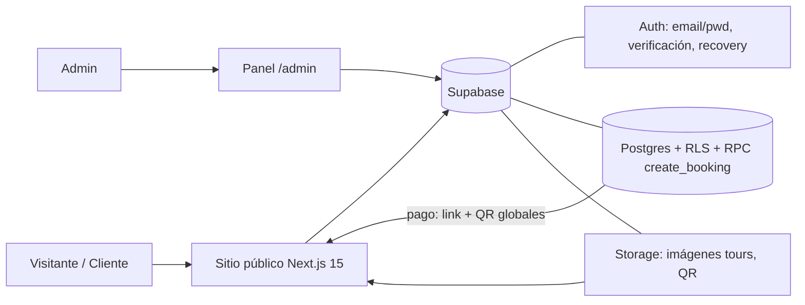
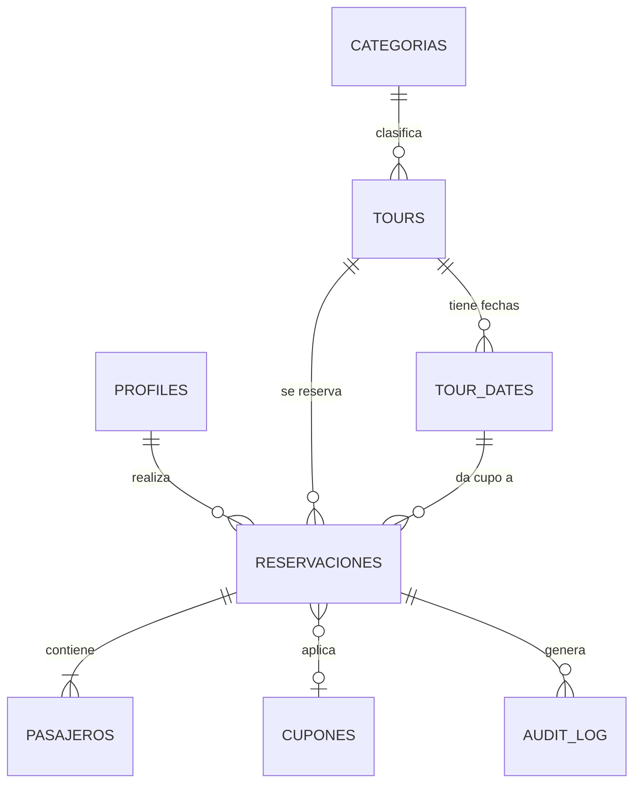

# Especificación — Homeland Tours: reservas reales + panel de administración

**Versión:** 1.1 · **Fecha:** 2026-08-25 · **Estado:** Borrador · **Nivel:** 3 — Completo

## 1. Resumen del proyecto

> **Pitch:** El sitio de Homeland Tours (Next.js 15, 12 tours, diseño propio) deja de ser un prototipo: los clientes se registran, hacen reservas reales con cupos por fecha y pagan por un link/QR configurado por el operador, que gestiona tours, disponibilidad, reservas, clientes y reportes en PDF desde un panel de administración profesional.

Hoy el sitio es una vitrina: el flujo de reserva termina en un mock (`bookingService.ts`), los 12 tours viven en `src/data/`, no hay cuentas reales ni forma de manejar cupos, precios ni reportes sin tocar código. El proyecto convierte el sitio en un sistema de reservas operable de punta a punta sobre **Supabase** (Auth + Postgres + Storage), agrega el flujo completo de autenticación (registro, login, recuperación de contraseña) y un panel de administración con dashboard, CRUD de tours, disponibilidad por fecha, gestión de reservas con pago manual (link + QR globales), clientes y reportes con generación de PDF.

## 2. Problema, objetivos y métricas de éxito

**Problema actual**
- Las reservas no existen de verdad: el checkout guarda en un mock y `localStorage`; no hay trazabilidad, cupos ni cobro.
- Todo el contenido (tours, categorías, cupones) está en código: cualquier cambio (precio, cupo, alta de tour) requiere tocar el código y redesplegar.
- No hay cuentas: no se conoce a los clientes, no se puede volver a contactarlos, no hay historial.
- El operador no tiene visibilidad: no sabe cuántas reservas hay, cuáles están pagadas, ni genera reportes.

**Objetivos y métricas**
- Habilitar reservas autogestionadas de verdad → ≥ 60 % de las reservas creadas sin intervención manual a los 2 meses.
- No sobrevender capacidad → 0 sobreventas en los primeros 3 meses (invariante garantizada a nivel de base de datos).
- Que el operador gestione todo desde el panel → 100 % de los cambios de contenido, cupos y estados de reserva se hacen sin tocar código; confirmar una reserva en < 2 min.
- Visibilidad del negocio → el operador genera un reporte de ventas en PDF en < 10 s.

**Restricciones** (dichas por el usuario, tan vinculantes como un RNF)
- El backend es **Supabase** (ya conectado vía MCP): Auth, Postgres y Storage.
- El pago es **link de pago + QR de pago, globales para todos los tours**, configurables por el admin; no hay pasarela automatizada (decisión explícita "de momento").
- El diseño visual actual **se mantiene sin ninguna modificación** (reafirmado explícitamente por el usuario, y ya documentado en el README): las páginas existentes (home, tours, detalle, booking, confirmación) conservan exactamente su aspecto actual; las pantallas públicas nuevas (login, registro, recuperación, "mis reservas") se integran con el lenguaje visual ya existente del sitio (mismas fuentes, paleta y componentes), sin redesiseño; el panel `/admin` es la única superficie diseñada nueva.
- Cuenta de administración fija: **webhomeland1@gmail.com** (contraseña proporcionada por el usuario; se crea en Supabase Auth y no se documenta en texto plano en ningún artefacto del repo).

## 3. Tipo de solución

**App web con panel de administración** (dos superficies en el mismo Next.js): sitio público de reservas + área `/admin`, con **Supabase como BaaS** (auth, datos, imágenes, reglas de acceso).

- **Backend propio (Node + Postgres gestionado) — descartado.** El usuario ya decidió Supabase y el proyecto ya está conectado a su MCP; duplicar esa infraestructura no aporta nada.
- **Panel SaaS genérico (Directus, Appsmith, etc.) — descartado.** No cubre los flujos propios (cupos por fecha con invariante de no sobrevender, pago link/QR global, reportes PDF a medida) y añade otra dependencia.
- **App móvil nativa — descartada.** El público ya usa el navegador; el panel debe ser usable desde el celular en el navegador.

## 4. Usuarios y roles

- **Visitante** — ver tours, itinerarios y precios sin cuenta. Necesidad: decidir si reserva.
- **Cliente (cuenta registrada)** — persona: viajero que investiga en el celu y reserva pocos días antes de salir; necesita un flujo corto, cupo garantizado y un voucher claro con cómo pagar. (Reservar requiere cuenta — decisión de usuario.)
- **Administrador** — único, la cuenta webhomeland1@gmail.com (rol `admin`). Necesidad: manejar tours, cupos, reservas y pagos sin ayuda técnica y exportar reportes.

## 5. Alcance incluido

- Autenticación completa: registro, login, logout, recuperación de contraseña por email (RF-01 a RF-03).
- Catálogo público servido desde Supabase, con migración 1:1 de los 12 tours actuales, 7 categorías y 3 cupones (RF-04, S-12).
- Disponibilidad real: fechas con cupo por tour, control de cupos libres y invariante de no sobrevender (RF-05).
- Flujo de reserva real con cuenta: selección, pasajeros, extras, descuento por grupo y cupones (lógica de `pricing.ts` conservada), reserva con código único y estado "Pendiente de pago" (RF-06).
- Voucher/confirmación con link de pago global + QR e instrucciones (RF-07) y su configuración por el admin (RF-08).
- Panel de administración protegido (RF-12) con: gestión de reservas y estados (RF-09), CRUD de tours con imágenes en Storage (RF-10), gestión de disponibilidad (RF-11), y en Fase 2: dashboard con KPIs (RF-13), clientes (RF-14), reportes con PDF (RF-15).
- En fases posteriores: correos transaccionales, "mis reservas" para el cliente, cupones gestionables, auditoría, 2FA, recordatorios, analítica (RF-16 a RF-22).

## 6. Fuera de alcance

- **Pasarela de pago automatizada** (Stripe, Mercado Pago, etc.) — el link/QR manual es la decisión vigente; pasarela es candidata a una fase futura si el volumen lo justifica.
- **Link/QR de pago por tour o por reserva** — de momento es un solo par global (decisión del usuario).
- **Multi-admin y roles granulares** — un solo admin; más admins o roles es fase futura.
- **App móvil nativa**, **multi-moneda**, **multi-idioma**, **blog/SEO avanzado**, **reseñas en la web** (las reseñas actuales se dejan como contenido estático o se migran sin flujo de moderación), **API de WhatsApp** (se conservan los enlaces `wa.me` actuales), **reembolsos automatizados** (todo reembolso es manual y fuera del sistema), **expiración automática de reservas pendientes** (candidata, Q-6).

## 7. Supuestos

*(Se marca el origen: usuario vs. generador.)*

- **S-01** *(usuario)*: Supabase es el backend (Auth + Postgres + Storage); el proyecto ya está conectado a su MCP. Si falso: reescritura de la capa de datos (esfuerzo L).
- **S-02** *(usuario)*: Pago mediante link + QR globales para todos los tours, configurables por el admin (decisión "de momento"). Si cambia a pasarela real: RF-07/08 se reescriben y el modelo gana entidad `payment` con estados automáticos.
- **S-03** *(usuario, respondido)*: La confirmación del pago es **manual por el admin**: la reserva nace "Pendiente de pago" y el admin la confirma tras verificar el pago. Si el admin prefiere confirmación automática: el flujo de estados cambia y aparece el riesgo de reservas sin pago.
- **S-04** *(usuario, respondido)*: Reservar **requiere cuenta** (login/registro). Si se permitiera invitado: el panel de "clientes" incluiría personas sin cuenta y el flujo de auth pierde obligatoriedad.
- **S-05** *(usuario)*: El admin es webhomeland1@gmail.com con la contraseña que el usuario proporcionó en la petición (no se repite aquí por seguridad). Se crea vía Supabase Auth; si se cambia después, se hace desde Supabase sin tocar código. Si falso (otra cuenta/clave): solo cambia el dato de siembra, no la arquitectura.
- **S-06** *(generador)*: Precios y reportes en **USD** (los precios actuales están en USD). Si falso (BOB o dual): formato en catálogo, reserva y reportes (esfuerzo S–M, fase 2/3).
- **S-07** *(generador)*: El cupo es **por tour y fecha**, sumando todos los tipos (group/semi/private) en un mismo total. Si falso (cupo por tipo): `tour_dates` gana columna `tour_type` y cambian RF-05/11 (esfuerzo S).
- **S-08** *(generador)*: Verificación de email **habilitada** al registrarse (seguridad por defecto de Supabase). Si se deshabilita: la cuenta queda activa al instante y RF-01 se simplifica (Q-1).
- **S-09** *(usuario)*: El diseño visual actual se mantiene **sin modificar** (reafirmado explícitamente por el usuario): cero cambios visuales en las páginas existentes; las pantallas nuevas del sitio público heredan el estilo existente; solo el panel `/admin` es superficie nueva. Si el usuario quisiera alargar el diseño del sitio al panel: retoque visual posterior (no cambia arquitectura).
- **S-10** *(generador)*: Los valores numéricos de la sección 9 son iniciales razonables para un operador de este tamaño; se ajustan al validar la Fase 1.
- **S-11** *(generador)*: Una reserva "Pendiente de pago" **retiene el cupo**: los cupos ocupados = confirmadas + pendientes. El admin libera el cupo al cancelar. Si falso (el cupo solo se retiene al confirmar): el último cupo puede ser "confirmado" por dos reservas pendientes (Q-2).
- **S-12** *(generador)*: Los 12 tours, 7 categorías y 3 cupones actuales migran 1:1 como datos iniciales mediante un script verificado antes del corte. Si el contenido cambia antes del corte: carga manual desde el panel.

## 8. Requisitos funcionales

### Prioridad Alta (sin esto el MVP no funciona)

- **RF-01 — Registro de cuenta.** Como visitante quiero registrarme con email y contraseña para poder reservar tours.
  - Alta · S — **Dado** que estoy en /register, **cuando** envío un email válido, contraseña de ≥ 8 caracteres y nombre, **entonces** se crea la cuenta en Supabase Auth, se envía el email de verificación (S-08) y, tras verificarla, puedo iniciar sesión. **Dado** un email ya registrado, **cuando** intento registrarme, **entonces** veo un mensaje claro con enlace a "¿Olvidaste tu contraseña?".
- **RF-02 — Login y logout.** Como cliente quiero iniciar sesión y mantenerla activa para no repetirla en cada reserva.
  - Alta · S — **Dado** una cuenta verificada, **cuando** inicio sesión, **entonces** la sesión persiste (24 h), el header muestra mi nombre y acceso a mis datos, y puedo volver al paso de reserva que tenía pendiente (RF-06). **Cuando** me deslogueo, **entonces** la sesión se destruye y vuelvo al home. Credenciales inválidas: mensaje genérico que no revela cuál campo falló.
- **RF-03 — Recuperación de contraseña.** Como cliente quiero recuperar mi contraseña si la olvido.
  - Alta · S — **Dado** que estoy en /login, **cuando** pido "olvidé mi contraseña" con mi email, **entonces** la respuesta en pantalla es idéntica exista o no la cuenta, y si existe recibo un email de Supabase con enlace de recuperación válido por 24 h; con el enlace defino contraseña nueva (≥ 8 caracteres) y puedo iniciar sesión.
- **RF-04 — Catálogo público desde Supabase.** Como visitante quiero ver los tours reales cargados desde la base de datos.
  - Alta · M — **Dado** que la base tiene tours activos, **cuando** abro /tours, /tours/[slug] u home, **entonces** veo solo tours activos con todo el contenido actual (imágenes, galería, itinerario, incluido/no incluido, qué llevar, info, precios por tipo) desde Supabase, sin `src/data/` en el camino de render; antes del corte los 12 tours actuales están migrados 1:1 (imágenes en Storage, S-12). **Dado** un tour creado o editado en el panel, **cuando** recargo, **entonces** el cambio es visible en < 1 min (un tour inactivo desaparece del sitio público).
- **RF-05 — Disponibilidad real sin sobrevender.** Como cliente quiero ver solo fechas con cupo real disponible.
  - Alta · M — **Dado** un tour con fechas abiertas por el admin (fecha + capacidad), **cuando** abro la disponibilidad, **entonces** veo solo fechas con cupo libre > 0 y su cantidad disponible; una fecha llena se muestra como "Agotado" (o no es seleccionable) y una fecha sin abrir no aparece. **Invariante (sistema):** ninguna reserva se puede insertar si cupo libre < pax, garantizada con una función de Postgres (RPC) que valida y escribe en una sola transacción con bloqueo de fila, incluso con dos clientes reservando el último cupo a la vez (S-11, S-07).
- **RF-06 — Flujo de reserva real con cuenta.** Como cliente quiero completar mi reserva y que quede registrada de verdad.
  - Alta · M — **Dado** que estoy logueado y seleccioné tour, tipo (group/semi/private), fecha con cupo, pax y extras, **cuando** completé los datos de pasajeros (nombre, documento, nacionalidad, comida — formulario actual) y confirmo, **entonces** se crea la reserva con código único `HT-XXXXX`, estado "Pendiente de pago", total calculado con la lógica actual (precio por tipo, descuento por grupo, cupones válidos), y el cupo queda retenido (S-11). **Dado** que no estoy logueado en el paso de confirmación, **cuando** llego a /booking, **entonces** me redirige a login conservando la selección; al autenticarme sigo donde estaba. **Dado** que la fecha se llenó mientras completaba, **cuando** confirmo, **entonces** recibo un error claro y se me ofrecen las fechas disponibles más próximas.
- **RF-07 — Confirmación con link de pago y QR.** Como cliente quiero saber exactamente cómo pagar y tener mi voucher.
  - Alta · S — **Dado** una reserva creada, **cuando** llego a /confirmation, **entonces** veo el voucher (código, tour, fecha, tipo, pax, pasajeros, desglose y total), el **link de pago global** como botón clicable, el **QR** como imagen descargable, e instrucciones de qué pasa después (el operador confirma el pago), todo dentro del diseño del voucher actual sin cambios a su layout (S-09). **Dado** que el admin aún no configuró el pago, **entonces** veo "El link de pago estará disponible pronto; comunicate por WhatsApp" con el botón de WhatsApp actual.
- **RF-08 — Pago global configurable.** Como admin quiero configurar el link de pago y el QR para todos los tours.
  - Alta · S — **Dado** el tab "Pago" del panel, **cuando** guardo link de pago, imagen del QR (subida a Storage) e instrucciones opcionales, **entonces** el cambio rige para todas las confirmaciones nuevas en < 1 min; siempre hay un único par vigente (el último guardado), editable en cualquier momento. El QR/link nunca se piden al cliente ni se configuran por tour (S-02).
- **RF-09 — Gestión de reservas y estados (admin).** Como admin quiero ver y gestionar todas las reservas.
  - Alta · M — **Dado** el tab "Reservas", **cuando** lo abro, **entonces** veo todas las reservas con filtros (estado, tour, fecha, cliente, código) y búsqueda; cada fila muestra código, cliente (nombre + email), tour, fecha, pax, total y estado; el detalle muestra pasajeros, desglose y métodos (link/QR). **Cuando** cambio el estado, **entonces** queda registrado con fecha-hora y el cupo se actualiza: *Pendiente de pago → Confirmada* (cupo sigue retenido, se marca `paid_at`), *→ Completada* (tras la fecha del tour), o *Cancelada* (exige motivo; libera el cupo; si estaba confirmada deja el marcador "reembolso manual pendiente" — el sistema no procesa dinero). Estados: `pendiente_pago | confirmada | completada | cancelada`.
- **RF-10 — CRUD de tours (admin).** Como admin quiero crear, editar y eliminar tours para mantener el catálogo al día sin código.
  - Alta · L — **Dado** el tab "Tours", **cuando** creo o edito un tour, **entonces** manejo: título y slug (único, editable solo si no tiene reservas), imagen principal y galería (subidas a Storage, reescaladas), categoría (de las 7 actuales o nueva categoría creada desde el panel), duración, dificultad, labels de actividad/tipo, destino, precios por tipo (group/semi/private), extras (nombre, precio, tipo), itinerario por día (título, comidas, alojamiento, descripción, actividades), incluido / no incluido / qué llevar, info (cancelación, salud, transporte, punto de encuentro), badge y estado activo/inactivo. **Dado** un tour con reservas existentes, **cuando** lo "elimino", **entonces** se desactiva (se conserva para historial y desaparece del sitio público); el borrado físico solo es posible si no tiene reservas.
- **RF-11 — Gestión de disponibilidad (admin).** Como admin quiero abrir y controlar fechas con cupo por tour.
  - Alta · M — **Dado** un tour en el tab "Disponibilidad", **cuando** agrego una fecha, **entonces** defino su capacidad (≥ 1) y queda reservable al instante; puedo editar la capacidad (nunca por debajo de los cupos ya ocupados por pendientes+confirmadas — si intento, error), o borrarla (solo si no tiene reservas pendientes/confirmadas; si las tiene, error con la cantidad). El listado muestra por fecha: capacidad, ocupado, libre.
- **RF-12 — Acceso al panel (solo admin).** Como admin quiero que solo yo pueda entrar al panel.
  - Alta · S — **Dado** la cuenta webhomeland1@gmail.com con rol `admin` (S-05), **cuando** inicio sesión y entro a /admin, **entonces** accedo al panel; **dado** cualquier otra cuenta (rol `client`), **cuando** intento /admin, **entonces** soy redirigido a la home y la negación ocurre a nivel de RLS en la base (los datos de administración no son legibles/escritibles por clientes aunque llamen a la API directamente). Todas las rutas de /admin exigen sesión; sin sesión redirigen a /login con retorno posterior.

### Prioridad Media (diferible a fases posteriores)

- **RF-13 — Dashboard profesional.** Como admin quiero un dashboard con las métricas que deciden mi operación. *(Solicitado explícitamente por el usuario; va a Fase 2 porque la Fase 1 ya opera reservas sin él.)*
  - Media · M — **Dado** /admin, **cuando** abro el dashboard, **entonces** veo: KPIs del período (reservas totales, pendientes de pago, ingresos por confirmadas, ticket promedio, clientes registrados), ocupación de los próximos 7 días por tour/fecha, top 5 tours por reservas, y la alerta de reservas pendientes de pago con más de 7 días; selector de período (semana, mes, 3 meses, año, rango libre).
- **RF-14 — Clientes.** Como admin quiero ver todos los clientes registrados. *(Solicitado explícitamente por el usuario; Fase 2.)*
  - Media · S — **Dado** el tab "Clientes", **cuando** lo abro, **entonces** veo todas las cuentas con nombre, email, fecha de registro, nº de reservas y total gastado; puedo buscar por nombre/email y abrir el detalle con su historial completo de reservas (código, tour, fecha, estado, total).
- **RF-15 — Reportes con PDF.** Como admin quiero reportes profesionales exportables en PDF. *(Solicitado explícitamente por el usuario; Fase 2.)*
  - Media · M — **Dado** el tab "Reportes", **cuando** elijo tipo de reporte (Ventas, Reservas, Clientes), el rango de fechas y genero, **entonces** descargo un PDF con marca de la empresa (logo, título, período) con tablas paginadas, subtotales y totales, generado en < 10 s con 12 meses de datos; también disponible la exportación CSV de los mismos datos. Reporte Ventas: por período y por tour (reservas, pax, ingresos confirmados, cancelaciones). Reporte Reservas: listado completo filtrado. Reporte Clientes: registros y gasto por cliente.
- **RF-16 — Correos transaccionales.** Como cliente quiero recibir por email la confirmación de mi reserva y cada cambio de estado.
  - Media · M — **Dado** una reserva creada, **cuando** el admin la confirma o la cancela, **entonces** el cliente recibe un email con el código, tour, fecha, estado y (si confirmada) recordatorio del pago/link; en la creación también. Envío vía Supabase Edge Function + proveedor de email (Resend); el fallo de envío no bloquea ni revierte la acción en el panel.
- **RF-17 — Mis reservas (cliente).** Como cliente quiero ver mis reservas y su estado.
  - Media · S — **Dado** que estoy logueado, **cuando** abro "Mis reservas", **entonces** veo mis reservas con estado, voucher y link de pago; puedo cancelar mi propia reserva mientras esté "Pendiente de pago" (libera el cupo al instante); una "Confirmada" no se cancela desde el cliente (se muestra "contacta al operador").

### Prioridad Baja (deseable)

- **RF-18 — Cupones gestionables.** Como admin quiero crear, activar y desactivar cupones con % de descuento y vigencias.
  - Baja · S — Los 3 cupones actuales (WELCOME10, BOLIVIA15, SUMMER20) migran como datos iniciales (S-12); desde el panel se crean nuevos con % y rango de fechas; un cupón vencido o inactivo es rechazado en el checkout con mensaje claro.
- **RF-19 — Auditoría de acciones del admin.** Como admin quiero un registro de qué se modificó y cuándo.
  - Baja · S — Cambios de estado de reservas y de tours (crear/editar/desactivar) quedan en tabla `audit_log` (quién, cuándo, entidad, antes/después); visible en el panel con búsqueda por entidad y fecha.
- **RF-20 — 2FA para el admin.** Como admin quiero doble factor en mi cuenta.
  - Baja · S — TOTP habilitable desde Supabase Auth para la cuenta admin; opcional (no obligatorio) para no frenar el uso diario.
- **RF-21 — Recordatorio previo a la salida.** Como cliente quiero un recordatorio antes de la fecha del tour.
  - Baja · S — Email (o WhatsApp manual asistido por la lista del panel) 72 h antes para reservas confirmadas; depende de RF-16.
- **RF-22 — Analítica.** Como admin quiero ver el embudo de visitas y conversiones.
  - Baja · S — Plausible o GA4 con eventos: inicio de reserva, reserva creada, pago visto (confirmation); sin integración más profunda que eso.

## 9. Requisitos no funcionales

Valores iniciales razonables (S-10), ajustables al validar la Fase 1.

- **Rendimiento:** primera carga del sitio público < 3 s en 4G; páginas del panel < 2 s; generación de PDF < 10 s con 12 meses de datos; RPC de creación de reserva < 1 s (p95).
- **Usabilidad:** reservar en ≤ 5 pasos desde la página del tour; tareas frecuentes del admin (confirmar, abrir fecha, ver reserva) en ≤ 3 clics; panel usable en pantalla de 360 px sin scroll horizontal.
- **Compatibilidad:** últimas 2 versiones de Chrome, Firefox, Safari y Edge; Android 10+ e iOS 15+ (móvil primero en el panel).
- **Disponibilidad:** ≥ 99,5 % en horario de uso principal (08–22 h) — heredada de la infraestructura Supabase/Vercel.
- **Escalabilidad:** 100 visitantes concurrentes en el sitio público y ~200 reservas/mes sin degradación (honesto para el tamaño del negocio).
- **Seguridad:** HTTPS obligatorio; RLS en todas las tablas (la sección 19 detalla políticas); sin datos de tarjeta en el sistema (el pago es externo, S-02); sesiones de 24 h; rate limiting en endpoints de auth (nativo de Supabase); CSP activa.
- **Integridad:** la invariante de no sobrevender (RF-05) se garantiza a nivel de base de datos, no solo de UI; integridad referencial completa (una reserva siempre apunta a tour, fecha y usuario válidos).
- **Accesibilidad:** mantener como mínimo el contraste actual del sitio (WCAG 2.1 AA en los componentes nuevos: formularios, panel).
- **Mantenibilidad:** cero contenido de tours en código tras la migración (S-12); configuración de pago y cupos editable desde el panel; migraciones de base versionadas y aplicables por MCP/CLI.

## 10. Arquitectura o enfoque técnico sugerido

Decisiones con su porqué:

- **Un solo Next.js 15 (el actual)** con dos superficies: sitio público y `/admin`. Un solo despliegue, un solo repo; el panel es una sección protegida, no un sistema aparte.
- **Supabase** para Auth (email/contraseña + verificación + recuperación, nativo), Postgres (datos y RLS) y Storage (imágenes de tours y QR). Es la restricción del usuario (S-01) y evita administrar servidores.
- **Acceso a datos desde el cliente con `supabase-js` + RLS**: la seguridad no depende de la UI — un cliente jamás puede leer/reescribir datos de admin ni crear reservas que violen cupos. La creación de reserva pasa por una **función de Postgres (`create_booking`)** que valida capacidad, retiene cupo y escribe reserva+pasajeros en una sola transacción: es lo que hace inviolable la invariante de no sobrevender ante concurrencia.
- **RLS por rol**: tabla `profiles` con `role` (`client`/`admin`) creada por trigger al registrarse; las políticas de cada tabla se basan en ese rol.
- **PDF en el cliente (jsPDF + autotable)**: reportes profesionales sin un servicio extra ni costo; la alternativa (puppeteer server-side) costaría infraestructura que no se justifica.
- **Correos transaccionales en Fase 2**: Supabase Edge Function + Resend (el email de auth ya es nativo de Supabase).
- **Estado de la reserva** en el cliente viaja por `BookingContext` (existente) hasta la creación; después todo es fuente de verdad en la base.

## 11. Modelo de datos preliminar

- **profiles** — `id` (→ auth.users), `full_name`, `phone`, `role` ('client' | 'admin'), `created_at`. Creada por trigger en el signup; la cuenta admin se siembra con rol `admin` (S-05).
- **categories** — `id`, `slug` (único), `label`, `emoji`, `image`, `position`. Siembra: las 7 actuales (S-12).
- **tours** — `id`, `slug` (único), `title`, `image`, `gallery` (jsonb), `badge`, `category_id`, `duration`, `difficulty`, `activity_label`, `type_label`, `destination`, `start_end`, `best_season`, `max_altitude`, `price_group`, `price_semi`, `price_private`, `summary` (text[]), `highlights` (text[]), `itinerary` (jsonb), `included` (text[]), `not_included` (text[]), `what_to_bring` (jsonb), `info` (jsonb), `extras` (jsonb), `active` (bool), `created_at`, `updated_at`. Espejo de la interfaz `Tour` actual (`src/lib/types.ts`) para migrar 1:1.
- **tour_dates** — `id`, `tour_id`, `date` (date), `capacity` (int ≥ 1), `created_at`; única `(tour_id, date)`. Cupo libre = `capacity` − Σ`pax` de reservas `pendiente_pago`/`confirmada` (S-07, S-11).
- **reservations** — `id`, `code` (único, `HT-XXXXX`), `user_id`, `tour_id`, `tour_date_id`, `tour_type` ('group'|'semi'|'private'), `pax`, `extras` (jsonb), `subtotal`, `group_discount`, `coupon_code`, `coupon_discount`, `total`, `status` ('pendiente_pago' | 'confirmada' | 'completada' | 'cancelada'), `payment_method` ('link' | 'qr'), `cancellation_reason`, `created_at`, `paid_at`, `cancelled_at`, `completed_at`.
- **booking_passengers** — `id`, `reservations_id`, `position`, `name`, `doc`, `country`, `meal`, `is_lead`.
- **coupons** — `code` (único), `discount_pct`, `active`, `valid_from`, `valid_to`. Siembra: WELCOME10, BOLIVIA15, SUMMER20 (S-12).
- **settings** — `key` (pk), `value` (jsonb), `updated_at`. Keys: `payment_link`, `payment_qr_url`, `payment_instructions` (S-02).
- **audit_log** (RF-19, Fase 3) — `id`, `admin_id`, `entity`, `entity_id`, `action`, `before` (jsonb), `after` (jsonb), `created_at`.

**RPC clave:** `create_booking(tour_id, date, tour_type, pax, extras, passengers, coupon_code)` → valida en transacción con `SELECT ... FOR UPDATE` sobre `tour_dates`, rechaza si cupo libre < pax, calcula totales, inserta reserva + pasajeros, devuelve la reserva o un error tipado (`date_full`, `coupon_invalid`…). Es el único camino de escritura de reservas.

## 12. Flujos principales

**1. Reservar un tour (cliente) — flujo definitorio**
1. El cliente ve el tour (puede llegar sin cuenta) y abre la disponibilidad: solo fechas con cupo libre.
2. Elige fecha, tipo, pax y extras; al llegar a la confirmación, si no está logueado, se le pide login/registro y la selección se conserva.
3. Completa los datos de pasajeros, aplica cupón (si quiere) y confirma.
4. La RPC crea la reserva "Pendiente de pago", retiene el cupo y muestra el voucher con link de pago + QR.
5. El cliente paga por el link/QR; el admin verifica y confirma (flujo 4).
- **Alterno — fecha se llena en el medio:** la RPC rechaza con `date_full`; la UI ofrece las próximas fechas disponibles.
- **Alterno — no paga:** la reserva queda "Pendiente de pago" reteniendo el cupo (S-11); el admin la cancela y el cupo se libera.
- **Alterno — cupón inválido/vencido:** el checkout lo rechaza antes de crear la reserva.

**2. Registro y autenticación (cliente)**
1. "Iniciar sesión" en el header → registro con email/contraseña/nombre → email de verificación → login.
2. Olvidó la contraseña → "olvidé mi contraseña" → email de Supabase → nueva contraseña → login.
- **Alterno — email ya registrado:** mensaje con enlace a recuperación.
- **Alterno — token de recuperación vencido (> 24 h):** se pide un nuevo enlace.

**3. Configurar el negocio (admin)**
1. "Tours" → crear/editar tours (RF-10) · "Disponibilidad" → abrir fechas con cupo (RF-11) · "Pago" → link + QR globales (RF-08).
- **Alterno — borrar tour con reservas:** se desactiva, no se borra.
- **Alterno — borrar fecha con reservas activas:** error con la cantidad de reservas afectadas.

**4. Gestionar una reserva (admin) — flujo definitorio**
1. Tab "Reservas" → filtra por "Pendiente de pago" → abre el detalle (pasajeros, total, método).
2. Verifica el pago del cliente → marca "Confirmada" (queda `paid_at`).
3. Tras la fecha del tour, las confirmadas pasadas pueden marcarse "Completada" (alimenta los reportes de ingresos).
- **Alterno — el cliente no paga y no responde:** se cancela con motivo; el cupo se libera al instante.
- **Alterno — cancelar una confirmada:** exige motivo y deja el marcador "reembolso manual pendiente" (el dinero se gestiona fuera del sistema).

**5. Generar un reporte (admin)**
1. "Reportes" → tipo (Ventas/Reservas/Clientes) + rango de fechas → generar.
2. Descarga PDF con marca de la empresa (o CSV).
- **Alterno — sin datos en el rango:** PDF con tabla vacía y el total cero (no error).

## 13. Integraciones necesarias

| Sistema | Propósito | Prioridad | Alternativa si falla o encarece |
|---|---|---|---|
| Supabase (Auth + Postgres + Storage) | Cuentas, datos, imágenes, RLS | Alta (F1) | No hay: restricción del usuario (S-01) |
| Link/QR de pago (proveído por el admin: banco/merchant) | Cobro de las reservas | Alta (F1) | Cambiar el valor configurado (RF-08); pasarela real en fase futura |
| Vercel (hosting actual) | Despliegue del Next.js | Alta (F1) | Netlify/Railway (equivalente esfuerzo) |
| Resend + Edge Function | Correos transaccionales (RF-16/21) | F2 | SMTP propio u otro proveedor (misma interfaz) |
| jsPDF + autotable | Generación de PDF (RF-15) | F2 | PDF server-side (puppeteer): más infra, solo si el cliente-side no alcanza |
| Plausible o GA4 | Embudo y conversiones (RF-22) | F3 | Sin analítica |

## 14. Criterios generales de aceptación

"Terminado" para cualquier entrega significa:

- Todos los RF Alta de la entrega verificados contra sus criterios, en entorno idéntico a producción.
- Flujo punta a punta probado sobre Supabase real: registro → verificación → login → reserva → voucher con link/QR → confirmación por el admin → estado visible en "Mis reservas"/panel.
- Los 12 tours, 7 categorías y 3 cupones migrados 1:1 y verificables en el sitio público (S-12).
- Invariante probada: dos reservas concurrentes sobre el último cupo → exactamente una exitosa.
- RLS probado: con una cuenta `client`, las llamadas directas a la API sobre tablas de admin y sobre reservas ajenas fallan.
- La cuenta admin (webhomeland1@gmail.com) entra al panel y ninguna cuenta `client` entra (UI + API).
- Probado en un teléfono real (360 px) y en escritorio; diseño visual actual intacto: cero cambios visuales en las páginas existentes (verificado con comparación visual de home, tours, detalle, booking y confirmación antes/después).
- Despliegue con HTTPS; cero datos mock de tours en el código del sitio público.

## 15. Riesgos y consideraciones

| # | Riesgo | Prob. | Impacto | Mitigación |
|---|---|---|---|---|
| R-01 | Clientes dejan reservas "Pendiente de pago" que retienen cupo y no pagan (S-11) | Alta | Medio | El admin cancela con 1 clic (RF-09) y el dashboard alerta pendientes > 7 días (RF-13); expiración automática como candidata (Q-6, F3) |
| R-02 | Sobreventa por concurrencia en el último cupo | Baja | Alto | RPC con transacción y bloqueo de fila (RF-05); caso de aceptación explícito (sección 14) |
| R-03 | Compromiso de la cuenta admin (único punto de control) | Baja | Alto | RLS como segunda línea, 2FA opcional (RF-20), contraseña fuera del repo, sesión de 24 h |
| R-04 | El pago manual genera fricción: clientes que pagan tarde o nunca | Media | Alto | Voucher con instrucciones claras + WhatsApp directo (RF-07); proceso de confirmación en < 2 min (sección 2); pasarela real como fase futura si la fricción se confirma |
| R-05 | Migración del contenido rico (itinerarios, extras, jsonb) con errores | Media | Medio | Script de migración versionado + checklist de verificación 1:1 antes del corte (S-12) |
| R-06 | Alcance expansivo ("y que también haga…") | Alta | Medio | Este documento define fases; lo nuevo entra al backlog salvo decisión explícita |
| R-07 | Confundir "Pendiente de pago" con venta en los reportes | Media | Medio | Los reportes de ingresos usan solo "confirmadas" (RF-15); el dashboard separa ambos (RF-13) |
| R-08 | Límites del plan gratuito de Supabase (bandwidth, datos) | Baja | Medio | Monitoreo del uso; plan Pro (≈ 25 USD/mes) cuando se acerque el límite (sección 21) |
| R-09 | El panel nuevo no encaja visualmente con el sitio y genera confusión | Baja | Bajo | El panel vive bajo /admin con identidad propia y no se enlaza desde el sitio público (S-09) |

## 16. Propuesta de MVP

**Qué incluye (Fase 1):** RF-01 a RF-12 — autenticación completa, catálogo desde Supabase con migración 1:1, disponibilidad real con invariante de no sobrevender, flujo de reserva con cuenta, voucher con link/QR de pago, configuración del pago global, gestión de reservas y estados, CRUD de tours, gestión de disponibilidad y protección del panel. Con esto el negocio **ya opera reservas de verdad de punta a punta**: el cliente se registra, reserva, sabe cómo pagar, y el admin lo gestiona todo desde el panel.

**Qué se recortó deliberadamente (con destino):**
- Dashboard (RF-13), clientes (RF-14) y reportes PDF (RF-15) → **Fase 2** — los pidió explícitamente el usuario, pero la operación de reservas ya funciona sin ellos; entran juntos para que el panel "profesional y completo" se entregue en un solo salto.
- Correos transaccionales (RF-16) y "Mis reservas" (RF-17) → **Fase 3** — en F1/F2 el estado se ve en el voucher y lo gestiona el admin.
- Cupones en panel (RF-18), auditoría (RF-19), 2FA (RF-20), recordatorios (RF-21), analítica (RF-22) → **Fase 3 / si hay demanda** (los cupones funcionan desde F1 con la siembra inicial, S-12).

**Cómo se valida:** ≥ 10 reservas reales autogestionadas en las primeras 4 semanas; 0 sobreventas en los primeros 3 meses; el admin confirma una reserva en < 2 min sin ayuda; 100 % de los cambios de contenido/cupos desde el panel (cero deployments para cambiar un precio o un cupo).

**Esfuerzo estimado del MVP:** 6 S + 5 M + 1 L ≈ 67–70 días de un desarrollador + colchón 25–30 % → **14–18 semanas**. Es un MVP grande porque el corazón del pedido no es una sola reserva sino el sistema completo que la sostiene (auth + datos + cupos + gestión).

**Recortes de emergencia** (si hay que lanzar antes):
- RF-10 con formulario reducido (título, imagen, categoría, precios por tipo, estado; el contenido rico de itinerario/extras se carga por migración y se edita después): RF-10 baja a M (−1 semana).
- Disponibilidad con listado simple sin vistas de calendario (ya es la base de RF-11, sin coste extra).
- Postergar RF-03 (recuperación) a una semana extra post-lanzamiento solo si la presión es extrema: es el único Alta "recortable" porque Supabase lo ofrece casi sin código, pero el usuario lo pidió explícito.

## 17. Fases sugeridas

| Fase | Objetivo | Contenido principal | Esfuerzo aprox. |
|---|---|---|---|
| F1 — MVP | Operar reservas de verdad | RF-01 a RF-12 (incluida migración 1:1, S-12) | 14–18 semanas |
| F2 — Panel profesional | Completar el panel pedido: visión y control | RF-13 (dashboard), RF-14 (clientes), RF-15 (reportes PDF) | 4–6 semanas |
| F3 — Experiencia y blindaje | Reducir fricción manual y proteger la operación | RF-16, RF-17, RF-18, RF-19, RF-20, RF-21, RF-22 | 4–5 semanas |

Cada fase entrega valor por sí misma: F1 ya reemplaza la operación por WhatsApp; F2 da la visibilidad y los reportes; F3 automatiza lo que hoy es manual. Suma total del alcance: 22–29 semanas de un desarrollador (rangos con colchón, no promesas).

## 18. Preguntas abiertas

| # | Pregunta | Qué cambia según la respuesta |
|---|---|---|
| Q-1 | ¿Se deja la verificación de email habilitada en Supabase al registrarse? (S-08: sí) | Si no: la cuenta queda activa al instante y RF-01 se simplifica (menos un paso en el flujo 2) |
| Q-2 | ¿Las reservas pendientes retienen el cupo? (S-11: sí) | Si no: cambia la invariante de RF-05 y el cálculo de cupo libre; aparece el riesgo de doble confirmación sobre el último cupo y habría que decidir quién "gana" |
| Q-3 | ¿Cupo por tour+fecha o por tour+fecha+tipo? (S-07: tour+fecha) | Si por tipo: `tour_dates` gana `tour_type` y cambian los formularios de RF-05/11 (esfuerzo S) |
| Q-4 | ¿Solo USD o también precios en BOB? (S-06: solo USD) | Si dual: formato en catálogo, reserva, panel y reportes (esfuerzo S–M, F2/F3) |
| Q-5 | ¿El email de confirmación se necesita ya en F1 o basta el voucher en pantalla? (actual: F2, RF-16) | Si ya: RF-16 sube a F1 (+~1 semana) y el flujo 1 termina con email, no solo con voucher |
| Q-6 | ¿Expiración automática de pendientes (p. ej. 48 h) para liberar cupo? (R-01) | Si sí: `expires_at` + job (cron de Supabase), entra a F3 (+~3–4 días) y cambia el flujo 4 (el admin hereda reservas auto-canceladas) |

## 19. Seguridad, privacidad y cumplimiento

**Datos recogidos y por qué:**
- Cuenta: nombre, email (auth), teléfono (contacto para el operador).
- Reserva: por pasajero nombre, documento, nacionalidad y tipo de comida (operación del tour: lista de pasajeros, permisos de ingreso, cocina).
- **Datos de tarjeta: ninguno.** El pago es externo vía link/QR del admin (S-02), así que el cumplimiento PCI no toca este sistema.

**Retención:** reservas y datos de pasajeros 5 años (respaldo administrativo/fiscal razonable); cuentas mientras estén activas + supresión a pedido del cliente (se conservan las reservas anonimizadas por coherencia contable).

**Políticas RLS (resumen ejecutivo):**
- `tours`/`categories`/`tour_dates`: lectura pública de lo activo; escritura solo `admin`.
- `reservations`: lectura propia (`client` dueño) o `admin` (todo); creación solo vía RPC autenticada; cambios de estado solo `admin`.
- `profiles`: lectura propia; `admin` lee todo (tab Clientes); un cliente no edita su rol.
- `settings`: lectura de autenticados (el voucher lo ve el cliente); escritura solo `admin`.
- `coupons`: lectura pública (se validan en el checkout); escritura solo `admin`.

**Amenazas principales y mitigación:**
- Compromiso de la cuenta admin → RLS como segunda línea, 2FA (RF-20), contraseña fuera del repo (S-05), sesión 24 h.
- Sobreventa por carrera concurrente → RPC transaccional con bloqueo de fila (RF-05).
- Abuso de la API (crear reservas basura, leer datos ajenos) → RLS + rate limiting nativo de Supabase en auth; validación en RPC.
- XSS/inyección → escape por defecto de React, parámetros siempre preparados (supabase-js), CSP.
- Pérdida de datos → backups (sección 20) + migraciones versionadas reversibles.

**Normativa:** Ley 045 de Bolivia (protección de datos personales): aviso de privacidad breve en el registro, datos mínimos, acceso/supresión a pedido. Facturación: fuera del sistema (como hoy, gestión manual del operador).

## 20. Despliegue y entornos

- **Entornos:** local (dev) + producción (Vercel + Supabase prod). Para este tamaño, un staging formal sería burocracia; si se quiere, la rama de dev de Supabase lo cubre sin costo extra.
- **Despliegue:** merge a `main` → despliegue automático en Vercel. Cambios de esquema y datos (RLS, RPC, siembras) como **migraciones versionadas** aplicadas por MCP/CLI antes o junto al deploy; reversibles cuando tienen sentido (borrar es raramente reversible: las migraciones destructivas se prueban en dev primero).
- **Backups:** PITR/copias diarias de Supabase (plan Pro) o exportación manual semanal en plan gratuito; exportación mensual de reservas a CSV como respaldo fuera de la plataforma.
- **Monitoreo:** verificador de uptime cada 5 min con alerta por email; logs de Supabase revisados al recibir cualquier reporte de error; el fallo de la RPC de reserva es el único evento que exige reacción inmediata (afecta ingresos).

## 21. Costos y licencias

| Concepto | Proveedor / plan | Costo mensual estimado |
|---|---|---|
| Dominio | el actual | ≈ 1–2 USD (anual prorrateado) |
| Hosting | Vercel (gratuito → Pro) | 0 → 20 USD |
| Base de datos + Auth + Storage | Supabase (Free → Pro) | 0 → 25 USD |
| Email transaccional | Resend (gratuito hasta ~3.000/mes, F2) | 0 → 20 USD |
| Pago | link/QR propios del admin (banco/merchant) | sin costo en este sistema (lo que ya paga el operador por su link) |
| PDF | jsPDF (libre, sin servidor) | 0 |
| Analítica | Plausible (≈ 9) o GA4 (0), F3 | 0 → 9 USD |
| **Total** | | **≈ 1–2 USD/mes al inicio; 55–76 USD en el peor caso** |

Licencias: Next.js/React TypeScript (MIT), supabase-js (MIT), jsPDF (MIT), fuentes e íconos actuales; fotos propias del operador. Ninguna licencia de pago obligatoria.

## Registro de cambios

- **1.1** — 2026-08-25 — El usuario reafirmó que el diseño visual actual debe mantenerse sin modificarse: S-09 pasó de supuesto del generador a restricción del usuario; se endureció en secciones 2 y 14 y en el criterio de RF-07 (el link/QR de pago se integra al voucher existente sin tocar su layout).
